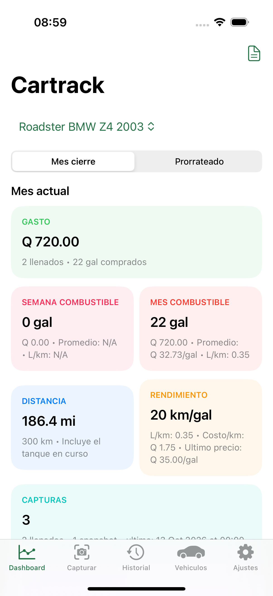
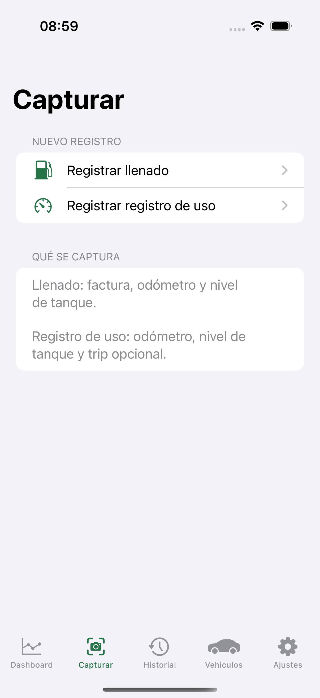
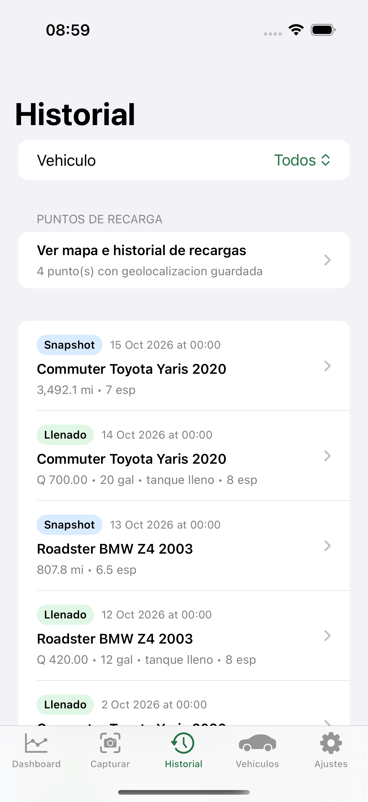
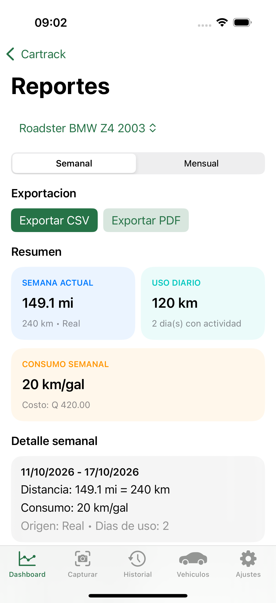
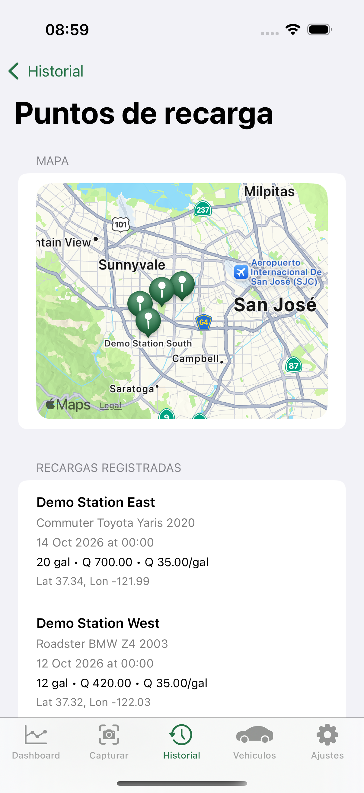
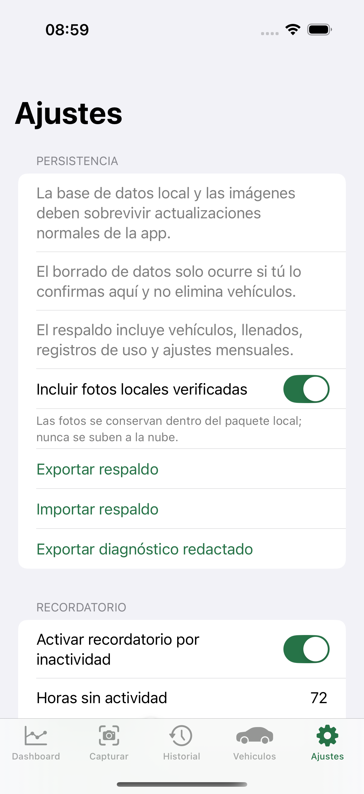

# Cartrack

Cartrack is a local-first iPhone app for understanding the real cost, consumption, and range of each vehicle.

Take a photo of a receipt, odometer, trip display, or fuel gauge. Cartrack reads the usable information on-device, prepares a reviewable record, and turns confirmed entries into a dependable fuel and usage history. It is built for the practical workflow of logging a fill-up or a quick dashboard reading—not for typing every number from scratch.

## Cartrack v2, at a glance

Version 2 is ready for daily, offline use on iPhone:

- Record complete or partial refuels, plus use snapshots between refuels.
- Read receipts and digital dashboard displays with on-device OCR.
- Show confidence and source per field; uncertain values are reviewed, never silently invented.
- Keep a separate history, metrics, calibration, and settings for each vehicle.
- Calculate fuel consumption, cost per distance, tank cycles, range, and projections from confirmed history.
- Track an analog fuel gauge as a calibratable scale rather than assuming it is linear.
- Export weekly and monthly CSV/PDF reports.
- Create versioned local backups, with an explicit choice to include local evidence photos.
- Work without an account or internet connection, in Spanish or English, with VoiceOver and Dynamic Type support.

### What v2 deliberately does not do

V2 has no active cloud sync, account system, or image upload. Receipt and dashboard photos remain on the device. A backup is a local, user-initiated transfer.

The data model is prepared for **v2.1** synchronization, but that future release will use a separate Supabase project and synchronize only minimal structured records. It will never upload original photos, optimized photo copies, thumbnails, local paths, or OCR image payloads.

## A short daily workflow

1. **Capture** — Start a fill-up when you have a receipt, or a snapshot when you only want to record odometer, trip, or fuel level.
2. **Review the prefill** — Cartrack checks image quality, runs OCR locally, validates fields against one another, and makes low-confidence values easy to correct or recapture.
3. **Confirm once** — The confirmed values, units, source, and confidence become part of the vehicle history. Interrupted sessions can be resumed without retaking valid photos.
4. **Use the history** — The dashboard, reports, and tank insight turn entries into costs, consumption, range estimates, and gauge calibration over time.

Fuel-gauge photos are intentionally review-first. A digital display can often be prefilled; an analog needle is only saved after the person using the app confirms its calibrated level.

## Current app screens

All screenshots below are generated from the sanitized simulator scenario used by the UI tests. They contain demonstration vehicles and data only.

### Dashboard — spending, consumption, distance, and captures



### Capture — begin a refuel or a usage snapshot



### History — chronological vehicle log



### Reports — weekly/monthly summaries and local CSV/PDF export



### Refuel map — saved locations stay attached to local entries



### Settings — backup and recovery controls



## Privacy and data lifecycle

Privacy is a product boundary, not a setting hidden in the app:

- OCR uses Apple Vision on-device; v2 does not send photo pixels to a remote service.
- Confirmed evidence is stored locally as optimized JPEG files linked by UUID and hash.
- Local backups are versioned and validated before import. They may include photos only when the user explicitly chooses that option.
- Diagnostics are opt-in, redact sensitive evidence, and are exported separately from backups.
- The repository contains only sanitized OCR transcripts and demo screenshots—never private receipts, dashboard photos, databases, routes, or credentials.

For the detailed policy, read [SECURITY.md](SECURITY.md), the [on-device OCR decision](docs/adr/ADR-003-on-device-ocr-manual-correction.md), and the [private-fixture decision](docs/adr/ADR-007-real-image-regression-and-private-fixtures.md).

## v2.1 synchronization roadmap

Cloud synchronization is a deferred, intentionally narrow follow-up to v2:

- It will use a **new, isolated Supabase project**; no existing database is touched.
- It will synchronize vehicles, refuels, snapshots, calibrated fuel levels, and minimal normalized OCR evidence.
- It will exclude photos, image bytes, paths, Vision text/bounding boxes, charts, cached metrics, diagnostics, and sensitive notes.
- It will support versioned records, idempotent updates, tombstones, and explicit resolution for critical conflicts such as odometer and financial values.

The full boundary is documented in the [v2.1 sync-readiness contract](specs/001-cartrack-v2/contracts/sync-readiness.md).

## Product specification and quality gates

The v2 source of truth is maintained in the Spec Kit package:

- [Product specification](specs/001-cartrack-v2/spec.md)
- [Technical plan](specs/001-cartrack-v2/plan.md)
- [Commit-by-commit task list](specs/001-cartrack-v2/tasks.md)
- [Acceptance matrix](specs/001-cartrack-v2/acceptance-matrix.md)
- [Test plan](specs/001-cartrack-v2/test-plan.md)
- [Release checklist](specs/001-cartrack-v2/release-checklist.md)
- [Project constitution](.specify/memory/constitution.md)

The test strategy covers domain rules, app integration, accessibility-aware UI flows, backup/restore contracts, storage/privacy limits, and sanitized OCR fixtures. Personal photographs remain ignored local fixtures and are never required by public CI.

## Run locally

Requirements:

- macOS with Xcode and an available iPhone Simulator.
- Swift 6-compatible toolchain.

Run the core coverage gate:

```bash
Scripts/check_core_coverage.sh 90
```

Run the public local verification suite on an already-created simulator:

```bash
CARTRACK_SIMULATOR_UDID=<existing-simulator-udid> Scripts/verify_local.sh
```

Regenerate the README screenshots from the sanitized UI scenario:

```bash
xcodebuild -project Cartrack.xcodeproj -scheme Cartrack \
  -destination 'platform=iOS Simulator,id=<existing-simulator-udid>' \
  -only-testing:CartrackUITests/CartrackSmokeUITests/testReadmeScreensShowKeyFlows test
```

The selector script never creates a simulator. Set `CARTRACK_SIMULATOR_UDID` when a verification run must remain on one existing device.

## Repository layout

- `Cartrack/` — SwiftUI app, capture, dashboard, history, reports, settings, and local services.
- `CartrackCore/` — models, analytics, fuel-scale rules, OCR parsing, persistence contracts, and domain services.
- `CartrackCore/Tests/` — fast domain and contract tests.
- `CartrackTests/` — iOS integration, storage, OCR, backup, and migration tests.
- `CartrackUITests/` — simulator UI workflows and sanitized README screenshots.
- `specs/001-cartrack-v2/` — approved product, technical, data, migration, sync, and acceptance specifications.
- `Scripts/` — coverage, privacy, preflight, local verification, and simulator helpers.
- `docs/` — ADRs, testing notes, and release documentation.

## Safe publishing checklist

Before pushing a product change:

1. Run `CARTRACK_SIMULATOR_UDID=<existing-simulator-udid> Scripts/verify_local.sh`.
2. Run `Scripts/preflight_publish.sh --require-remote`.
3. Confirm that no private invoices, odometer/fuel-gauge photos, databases, backups, or route exports are tracked.
4. Keep only sanitized OCR text fixtures and sanitized demo screenshots in Git.
5. Review [SECURITY.md](SECURITY.md) before making the repository public.
